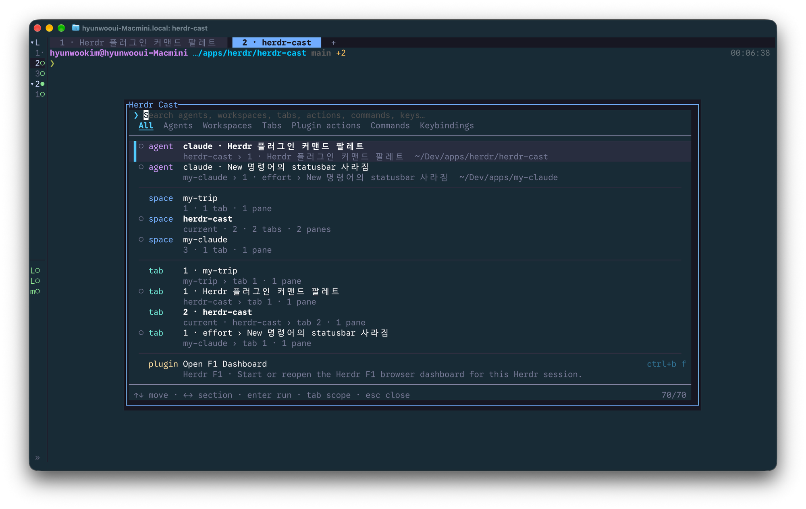

# herdr-cast

[한국어](README.md) | **English**



A Spotlight/Raycast-style command palette for [Herdr](https://herdr.dev). Open a popup with one key, search, and press Enter.

| Scope | Lists | Runs |
| --- | --- | --- |
| Agents | Every agent, sorted by status (blocked → done → working → idle) | Focus its pane (`agent.focus`) |
| Workspaces | Sidebar order, tab/pane counts, agent status | Focus the workspace |
| Tabs | Tab-bar order within each workspace | Focus the tab |
| Plugin actions | Every `[[actions]]` of enabled plugins | Invoke the action; shows its key if one is bound |
| Commands | `[[keys.command]]` entries in `config.toml` | Run it the way Herdr does for each type: `shell`, `pane`, `popup`, `plugin_action` |
| Keybindings | Your effective keymap: Herdr defaults plus your config | Run the matching socket API call (see below) |

Search is fzf-style fuzzy matching and supports Hangul initial-consonant (초성) search (`ㅇㄷ` → `인덱스 DB`). Space-separated terms must all match, in any order (`tab new` → `New tab`).

## Install

Requires Go 1.24 or newer.

```bash
# Install from GitHub (runs go build during install)
herdr plugin install DevooKim/herdr-cast

# Or link a local checkout
go build -o bin/herdr-cast ./cmd/herdr-cast
herdr plugin link .
```

Bind a key in `~/.config/herdr/config.toml`, then apply it with `herdr server reload-config` (or `prefix+shift+r`):

```toml
[[keys.command]]
key = "prefix+space"
type = "plugin_action"
command = "devookim.herdr-cast.open"
description = "command palette"
```

## Configuration

Put a `config.toml` in the plugin's config directory (`herdr plugin config-dir devookim.herdr-cast`, usually `~/.config/herdr/plugins/config/devookim.herdr-cast/`). Without the file, defaults apply. Changes take effect the next time the palette opens.

```toml
# Hide scopes you don't use. They disappear from the list, the scope bar,
# and tab cycling.
# agents, workspaces, tabs, plugin_actions, commands, keybindings
disabled_scopes = ["keybindings", "commands"]

# Popup size: a percentage string or a number of terminal cells.
# Defaults to 80% × 75%.
width = "80%"
height = "75%"
```

Unknown scope names and invalid sizes show a warning at the bottom of the palette; an invalid size falls back to the default.

## Keys

| Key | Action |
| --- | --- |
| type | Search |
| `↑` `↓` / `ctrl+p` `ctrl+n` / `ctrl+k` `ctrl+j` | Move |
| `pgup` `pgdown` `home` `end` | Page / first / last |
| `←` `→` | Jump to the first row of the previous / next scope (move the search cursor with `ctrl+b` `ctrl+f`) |
| `enter` | Run |
| `tab` / `shift+tab` | Switch scope (All → Agents → Workspaces → Tabs → Plugin actions → Commands → Keybindings). The last scope is remembered |
| `esc` | Clear the search, or close when it is empty |
| `ctrl+c` | Close |

Items that need a name (new tab, rename workspace, …) prompt inside the palette, and closing a pane, tab, or workspace asks for confirmation.

## Which keybindings can run

Herdr has no API for plugins to trigger its built-in key actions, so herdr-cast maps each action to socket API calls, following how Herdr's own client handles keys (`src/client/shell/actions.rs`).

- **Runnable**: reload config, new/rename/close/previous/next workspace, new worktree, previous/next agent, new/rename/close/previous/next tab, move tab left/right, split, close/rename/clear pane, edit scrollback, zoom, focus/swap/resize pane, cycle pane
- **Key hint only**: help, settings, detach, workspace navigation, session navigator, open/remove worktree, open notification target, copy mode, resize mode, toggle sidebar, last pane, and the indexed `1..9` jumps. These exist only inside the client UI, so a plugin cannot run them; selecting one tells you which key to press.

Actions without a key (for example an unbound `next_agent`) can still run from the palette.

Clear pane is listed only on Herdr 0.9.2+ servers, where `pane.clear` exists.

## How it works

- The palette is a plugin pane with `placement = "popup"`. A popup has no pane ID, so the target location is read from `HERDR_PLUGIN_CONTEXT_JSON` (the tiled pane under the popup).
- `session.snapshot`, `agent.list`, and `plugin.list` are fetched in parallel; the UI appears without waiting for them.
- The keymap layers built-in defaults, then `herdr --default-config`, then your `config.toml`.
- Herdr allows one popup at a time (`ui_busy`). Anything that opens Herdr UI — plugin actions, `pane`/`popup` commands, edit scrollback — is handed to a detached `herdr-cast exec` process that runs after the palette exits and its popup closes, and reports failures as a Herdr notification. Quick API calls such as focus changes run inside the palette and show errors at the bottom.
- `pane`/`popup` custom commands run through `/bin/sh -c` and `shell` commands through `/bin/sh -lc`, in the focused pane's working directory, just like Herdr. They get the same `HERDR_ACTIVE_WORKSPACE_ID`, `HERDR_ACTIVE_TAB_ID`, `HERDR_ACTIVE_PANE_ID`, and `HERDR_ACTIVE_PANE_CWD` variables.

## Development

```bash
go test ./...
go build -o bin/herdr-cast ./cmd/herdr-cast

# Print palette rows for the current session without the UI (run inside a Herdr pane)
./bin/herdr-cast list            # everything
./bin/herdr-cast list split      # search

# Open the popup
herdr plugin action invoke devookim.herdr-cast.open
```

Errors from deferred jobs are also written to `$HERDR_PLUGIN_STATE_DIR/exec.log`.
